#  온기 (溫氣)

**필요한 순간에 닿는, 가장 익숙한 목소리**

부모가 늘 아이 곁에 있을 수는 없다.  
아이가 친구와 싸운 날, 시험을 망친 날, 부모가 보고 싶은 날, 그 순간 가장 듣고 싶은 건 부모의 한마디다.

온기는 부모가 상황별로 미리 남긴 목소리를,  
아이가 스피커에 말을 걸면 **어떤 순간인지 스스로 알아듣고** 들려주는 온디바이스 AI 스피커다.

<p align="center">
  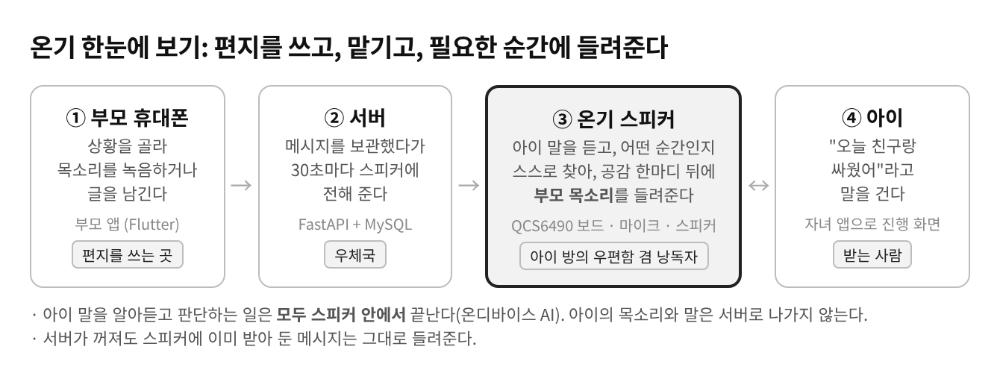
</p>

---

## 핵심 차별점

**일반적인 AI 스피커**

```text
아이 말 → 클라우드 AI → AI가 만든 대답
        ↓
아이의 목소리와 속마음이 집 밖 서버로 나가고, 대답은 부모의 말이 아니다
```

**온기 방식**

```text
아이 말 → [스피커 안] 받아쓰기 → 상황 판단 → 공감 한마디 → 부모가 남긴 메시지
```

온기는 아이 말의 인식과 판단을 **모두 스피커(QCS6490 보드) 안에서** 끝낸다.  
서버로는 "몇 시에 어떤 메시지를 들었는지"만 올라가고, 아이가 한 말은 밖으로 나가지 않는다.

또한 AI가 대신 위로하는 것이 아니라, **부모가 직접 남긴 말**을 맞는 순간에 들려준다.  
엉뚱한 순간에 메시지가 나오면 오히려 상처가 될 수 있으므로, 확실하지 않으면 공감 한마디만 하고 메시지는 틀지 않는다.

---

## 시스템 구조

<p align="center">
  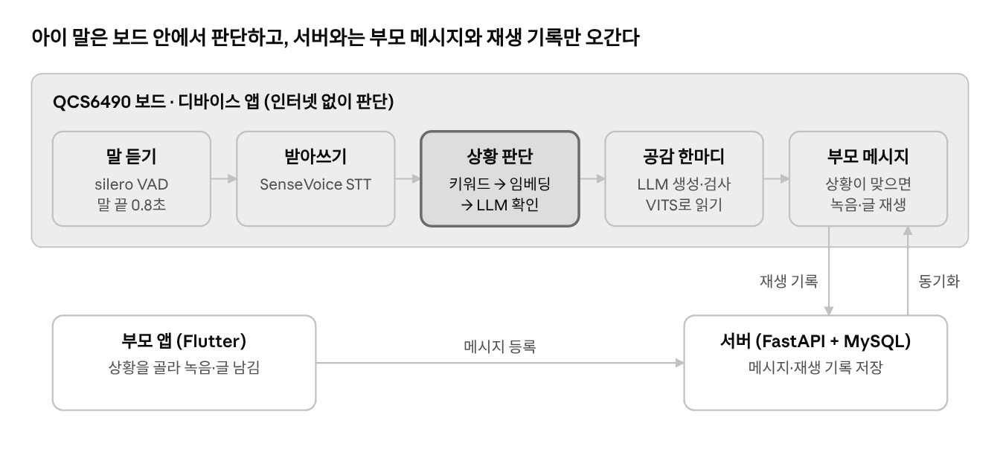
</p>

온기는 **부모 앱 · 서버 · 온기 스피커(디바이스) · 자녀 앱**의 네 부분으로 이루어진다.

1. 부모가 부모 앱에서 상황을 골라 목소리나 글로 메시지를 남긴다.
2. 서버(FastAPI + MySQL)가 메시지를 보관한다.
3. 온기 스피커가 30초마다 서버에 새 메시지를 물어 받아 보드 안에 저장한다.
4. 아이가 말을 걸면 스피커가 보드 안에서 받아쓰기 → 상황 판단 → 공감 한마디 → 부모 메시지 재생까지 처리한다.
5. 자녀 앱은 진행 화면(듣는 중 · 생각하는 중 · 공감 · 메시지)을 보여 주고, 들은 메시지를 온기기록에 모은다.
6. 재생 기록은 서버로 올라가 부모가 "아이가 언제 어떤 메시지를 들었는지" 확인한다.

---

## 온디바이스 AI 구조

<p align="center">
  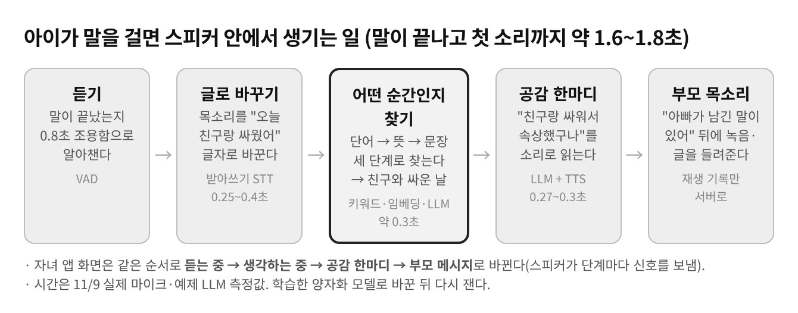
</p>

아이의 말이 끝나고 첫 소리가 나기까지 **약 1.6~1.8초**(목표 3초)가 걸린다.  
판단에 쓰는 AI 모델 네 개(받아쓰기 · 임베딩 · LLM · 음성 합성)가 모두 보드 안에 들어 있어,  
인터넷이 끊겨도 이미 받아 둔 메시지는 들려줄 수 있다.

---

## 핵심 기술

### 상황 판단 3단계

<p align="center">
  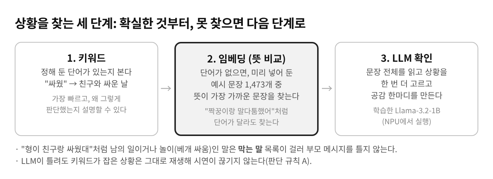
</p>

- **1단계 키워드**  
  "싸웠", "망쳤"처럼 상황마다 정해 둔 핵심 단어가 있으면 바로 그 상황으로 정한다. 빠르고 틀리지 않는다.

- **2단계 임베딩 (뜻 비교)**  
  문장을 숫자 384개로 바꿔 미리 넣어 둔 예시 문장 1,473개와 비교한다.  
  단어가 달라도 뜻이 비슷하면 찾고, 일반 대화보다 **확실히 가까울 때만** 상황으로 정한다.

- **3단계 LLM 확인**  
  팀이 학습시킨 Llama-3.2-1B가 문장 전체를 읽고 상황을 다시 고르며 공감 한마디를 만든다.  
  키워드가 잡은 상황은 LLM 결과가 달라도 그대로 따른다.

### 임베딩 판단

<p align="center">
  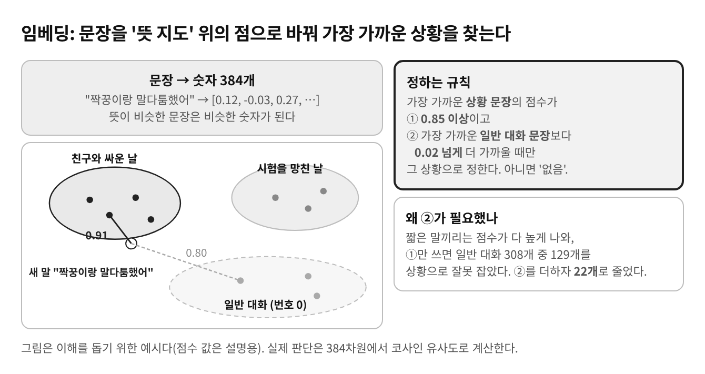
</p>

- paraphrase-multilingual-MiniLM-L12-v2를 int8 ONNX(118MB)로 변환해 보드 CPU에서 실행
- 보드용 SentencePiece 토크나이저를 직접 구현
- 판단 기준: 유사도 0.85 이상 + 일반 대화와의 차이 0.02 이상
- 일반 대화 오인식 129/308 → 22/308로 감소, 상황 문장 정답률 96.6%

### 학습 데이터와 LLM

- 상황 12개 (4분류: 학교·공부 / 친구 / 마음 / 가족·특별한 날)
- 학습 데이터 1,061문장, 평가 데이터 183문장
- Llama-3.2-1B 미세조정 → 평가 정확도 **95.6%** (형식 깨짐 0)
- (주)마음AI의 양자화를 거쳐 보드 NPU에서 실행

### 안전과 개인정보

- 아이 말은 스피커 밖으로 나가지 않음 (서버에는 메시지 번호와 시각만 저장)
- 위기 표현이 들리면 메시지 대신 도움 안내(청소년 상담 1388)
- 메시지가 없는 상황은 상황 번호만 부모에게 알려 메시지 작성을 유도

---

## 서비스 화면

### 부모 앱

상황을 골라 아이에게 남길 말을 목소리나 글로 남기고, 아이가 들은 메시지를 확인한다.

<table>
  <tr>
    <td width="50%" align="center">
      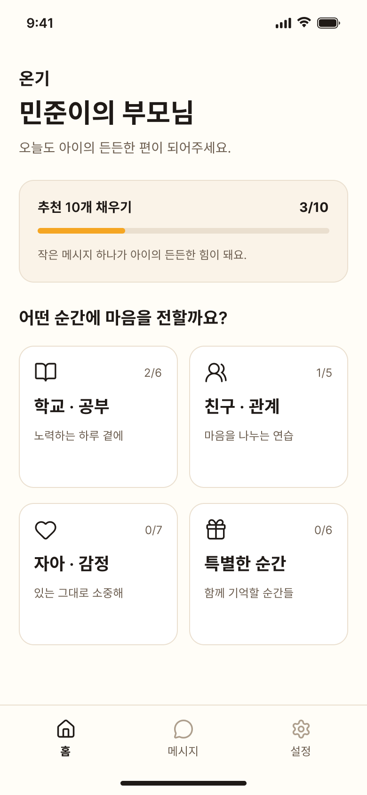
      <br/><b>부모 홈</b>
    </td>
    <td width="50%" align="center">
      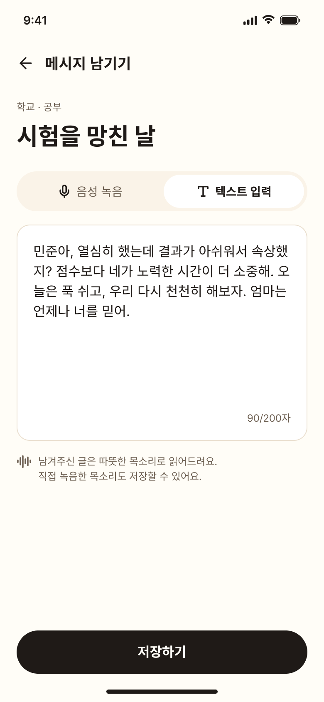
      <br/><b>메시지 작성</b>
    </td>
  </tr>
</table>

### 자녀 앱

아이가 말을 걸면 듣는 중 → 공감 한마디 → 부모 메시지 순서로 진행되고, 들은 메시지는 온기기록에 남는다.

<table>
  <tr>
    <td width="25%" align="center">
      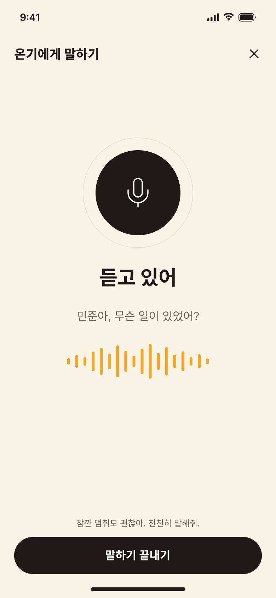
      <br/><b>듣는 중</b>
    </td>
    <td width="25%" align="center">
      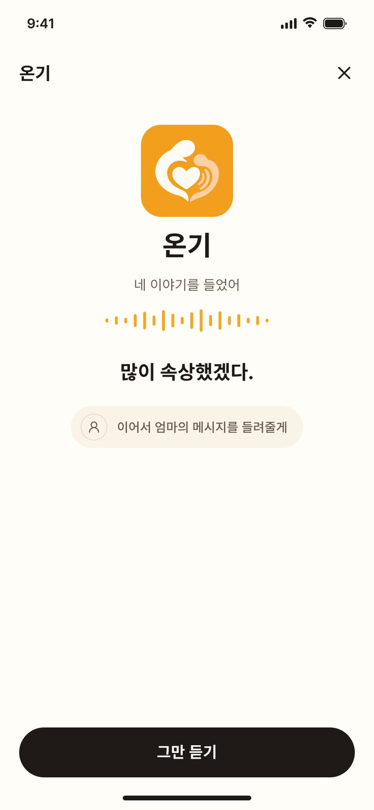
      <br/><b>공감 한마디</b>
    </td>
    <td width="25%" align="center">
      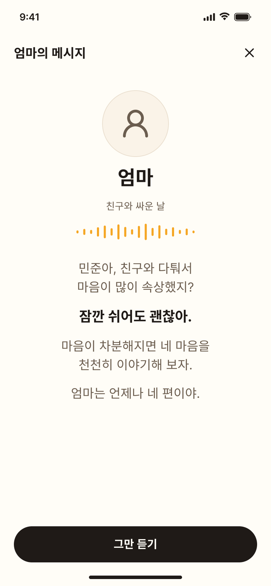
      <br/><b>부모 메시지 재생</b>
    </td>
    <td width="25%" align="center">
      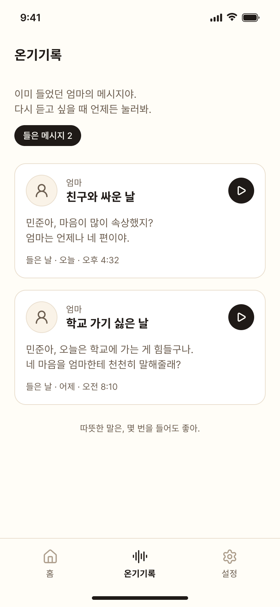
      <br/><b>온기기록</b>
    </td>
  </tr>
</table>

---

## 시연 구성

<p align="center">
  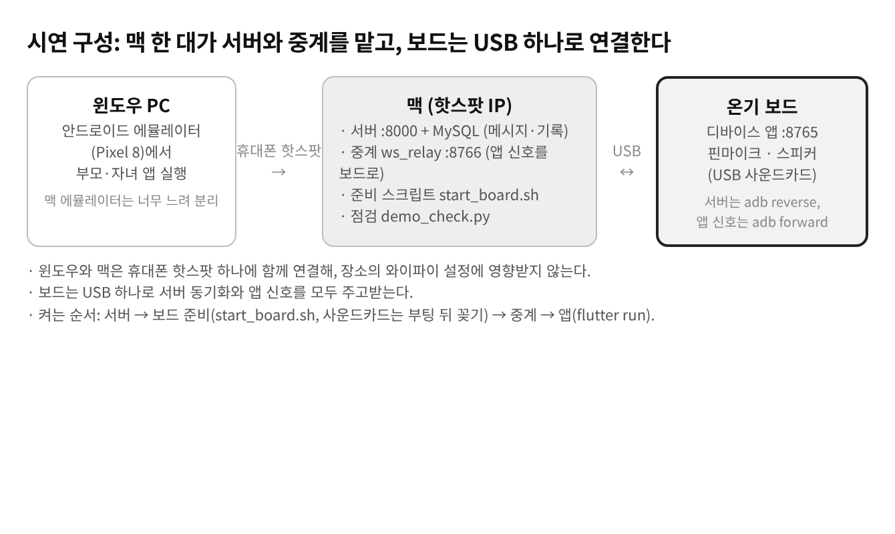
</p>

- 윈도우 PC: 안드로이드 에뮬레이터에서 부모·자녀 앱 실행
- 맥: 서버(:8000) + MySQL, 앱 신호 중계(ws_relay :8766)
- 윈도우와 맥은 휴대폰 핫스팟 하나에 함께 연결해 장소의 와이파이 설정에 영향받지 않는다
- 온기 보드: 맥과 USB 하나로 서버 동기화(adb reverse)와 앱 신호(adb forward)를 모두 주고받는다
- 켜는 순서: 서버 → 보드 준비(`device/tools/start_board.sh`) → 중계(`device/tools/ws_relay.py`) → 앱(`flutter run`)

---

## 기술 스택

| 영역 | 기술 |
|---|---|
| App | Flutter, Dart |
| Server | Python, FastAPI, MySQL |
| Device | Kotlin, Android (Qualcomm QCS6490 보드) |
| On-device AI | Llama-3.2-1B (미세조정·양자화, NPU), SenseVoice (받아쓰기), VITS (음성 합성), MiniLM 임베딩 (ONNX int8) |
| 연결 | REST API 19개, WebSocket (앱 ↔ 디바이스 신호 규격 v1.2), ADB (USB) |

---

## 레포지토리 구성

| 폴더 | 설명 | 담당 |
|---|---|---|
| [`app/`](app) | 부모·자녀 앱 (Flutter) | 서유정 |
| [`server/`](server) | 백엔드 API (FastAPI + MySQL) | 황정범 |
| [`device/`](device) | 보드 안 디바이스 프로그램 (Kotlin), 보드 준비·중계 도구 | 공지현 |
| [`ai/`](ai) | 학습·평가 데이터, 보드 안 AI 서버, 도구 스크립트 | 박석준 |
| [`docs/`](docs) | 개발 문서, 신호 규격서 | 전원 |

### 주요 문서

- [온기 개발 문서 v1.2](docs/온기_개발문서_v1.2.pdf)
- [신호 규격서 (앱 ↔ 디바이스)](docs/신호규격서.txt)

---

## 팀 구성

**7분반 5팀 AI큐**

| 이름 | 역할 |
|---|---|
| 공지현 (팀장) | 기획·PM, 디바이스(보드) 프로그램 개발, 앱 ↔ 디바이스 신호 규격 설계, 보드 AI 통합·시연 구성 |
| 박석준 | 학습 데이터 구축, LLM 학습·평가, 보드 AI 서버 |
| 황정범 | 백엔드 API 서버 개발, DB 설계 |
| 서유정 | 부모·자녀 앱 개발, UI/UX |

---

> 2026학년도 2학기 모바일시스템응용프로젝트 | 한성대학교 × (주)마음AI 산학협력
